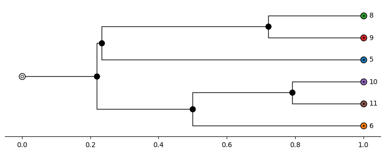
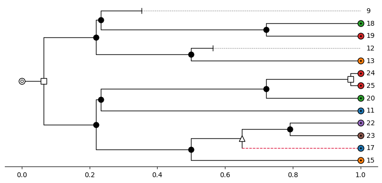
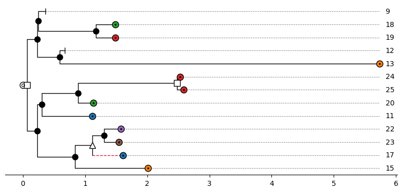
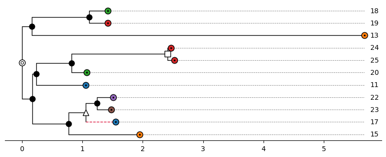
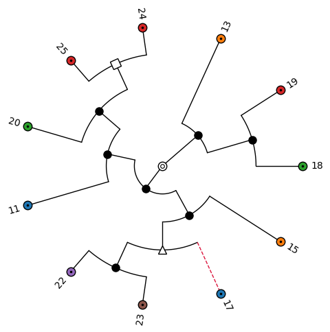
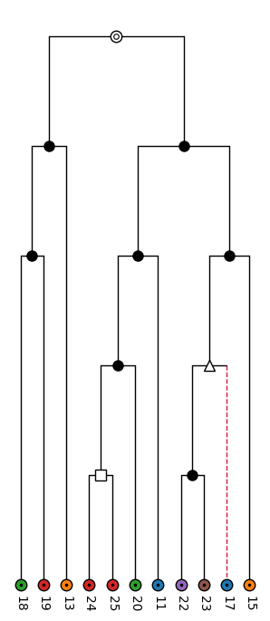
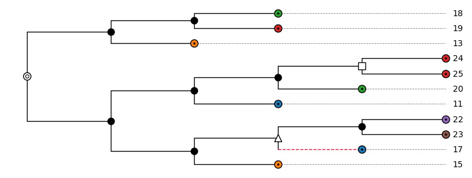
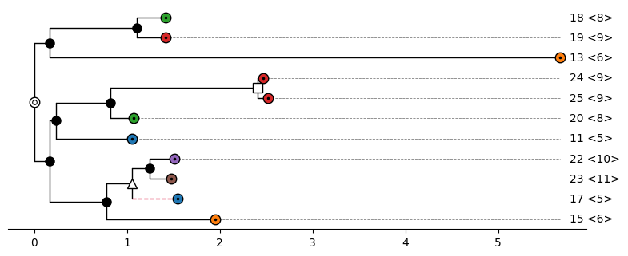
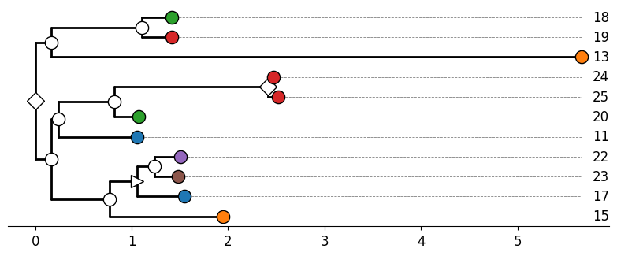

# Tree visualization

The function `visualize` in the module `asymmetree.visualization.tree_vis` (also available from
`asymmetree.visualization`) draws a simulated species or gene tree. It is a thin wrapper around the
`plot_tree` function of [tralda](https://github.com/david-schaller/tralda), which does the layout
and the rendering, and adds the AsymmeTree default style for the different event types.

Rendering requires matplotlib or plotly, which are optional dependencies:

```
pip install asymmetree[matplotlib]   # matplotlib backend (default)
pip install asymmetree[plotly]       # plotly backend
pip install asymmetree[viz]          # both
```

## Basic usage

```python
import asymmetree.treeevolve as te
from asymmetree.visualization import visualize, assign_colors

S = te.species_tree_n_age(6, 1.0)

# dated gene tree (with losses)
dated_gene_tree = te.dated_gene_tree(S, dupl_rate=0.3, loss_rate=0.3, hgt_rate=0.3)

# gene tree with rate heterogeneity (with losses)
full_gene_tree = te.rate_heterogeneity(
    dated_gene_tree,
    S,
    base_rate=1.0,
    autocorr_variance=0.1,
    rate_increase=("gamma", 0.5, 2.2),
    inplace=False,
)

# gene tree with losses pruned
pruned_gene_tree = te.prune_losses(full_gene_tree)

# assign colors and visualize
species_colors, gene_colors = assign_colors(S, dated_gene_tree)
visualize(S, color_dict=species_colors, path="S.png", distance_axis=True)
visualize(dated_gene_tree, color_dict=gene_colors, path="T1.png", distance_axis=True)
visualize(full_gene_tree, color_dict=gene_colors, path="T2.png", distance_axis=True)
visualize(pruned_gene_tree, color_dict=gene_colors, path="T3.png", distance_axis=True)
```

**Species tree:**



**Dated gene tree (with losses):**



**Full gene tree (with losses and rate heterogeneity):**



**Pruned gene tree (with losses pruned):**



The `path` argument saves the figure to a file, and the format is derived from the extension (e.g.,
`.png`, `.pdf`, or `.svg` for matplotlib). Use `show=True` to display the figure (in addition). The
function returns `(fig, ax)` for the matplotlib backend and a plotly `Figure` for the plotly
backend, so that the figure can be modified afterwards.

## Colors

The function `assign_colors(species_tree, gene_tree)` assigns a unique color to each non-loss
species leaf and to each non-loss gene the color of the species to which it belongs. The functions
`assign_species_colors(tree)` and `assign_gene_colors(tree, species_colors=None)` perform the two
steps separately. The returned dictionaries map leaf labels to colors and are passed to `visualize`
with the argument `color_dict`. Leaves that do not appear in `color_dict` are drawn in white.

## Default style

If no `tree_style` is given, the AsymmeTree default style is used. The symbol of a node depends on
its `event` attribute:

| Node                             | Symbol                                                     |
| -------------------------------- | ---------------------------------------------------------- |
| Extant leaf                      | circle with a dot, filled with the color from `color_dict` |
| Root                             | white circle with an inner ring                            |
| Speciation (`"S"`)               | black filled circle                                        |
| Duplication (`"D"`)              | white square                                               |
| Horizontal gene transfer (`"H"`) | white triangle                                             |
| Gene conversion (`"GC"`)         | black star                                                 |
| Loss (`"L"`)                     | cap                                                        |

Edges that were created by a horizontal gene transfer (nodes with a truthy `transferred` attribute)
are drawn as dashed crimson lines. The size of all symbols can be adjusted with `scale_symbols` and
the size of the text with `fontsize`.

## Layout and edge lengths

The most important options that are passed through to tralda are the following.

**`layout_mode`** controls the orientation of the tree:

- `"horizontal"` (default): root on the left, leaves on the right.
- `"vertical"`: root at the top, leaves at the bottom.
- `"circular"`: root in the center, leaves on the outside.

**`edge_length_mode`** controls how the positions along the depth axis are determined:

- `"attr"` (default): the length of an edge is read from a node attribute, which is `"dist"` by
  default and can be changed with `edge_length_attr`. Leaves that end before the maximum depth
  (e.g., losses) are connected to their labels by dashed gray lines.
- `"uniform"`: every edge has length 1.
- `"even"`: all leaves end at the same depth (cladogram), and the internal nodes are distributed
  evenly along each path from the root.
- `"rank"`: internal nodes are placed at their topological depth, i.e., the number of edges from the
  root, and the leaves are aligned.

**`node_rank_mode`** controls how internal nodes are placed along the perpendicular axis relative to
their children: `"mean"` (default; between the first and the last child), `"first"`, `"last"`, or
`"node"` (every node gets its own position, which avoids overlapping labels when the labels of
internal nodes are shown).

**Circular layout with even edge lengths:**

```python
visualize(
    pruned_gene_tree,
    color_dict=gene_colors,
    path="T3_circular.png",
    layout_mode="circular",
    edge_length_mode="even",
)
```



**Vertical layout with edge lengths according to the topological depth:**

```python
visualize(
    pruned_gene_tree,
    color_dict=gene_colors,
    path="T3_vertical.png",
    layout_mode="vertical",
    edge_length_mode="rank",
)
```



**Horizontal layout with uniform edge lengths:**

```python
visualize(
    pruned_gene_tree,
    color_dict=gene_colors,
    path="T3_uniform.png",
    edge_length_mode="uniform",
)
```



## Distance axis

With `distance_axis=True`, an x-axis is shown that gives the distance from the root, i.e., the sum
of the edge lengths. This requires the matplotlib backend, `layout_mode="horizontal"`, and
`edge_length_mode="attr"`, otherwise a `ValueError` is raised. Without the distance axis, the depth
of the tree is rescaled to the interval $[0, 1]$ by tralda.

## Species information

For gene trees, `species_info=True` appends the species to which a gene belongs (the `reconc`
attribute) to the labels of the non-loss leaves. The given tree is not modified.

```python
visualize(
    pruned_gene_tree,
    color_dict=gene_colors,
    path="T3_species_info.png",
    species_info=True,
    distance_axis=True,
)
```



## Renderer options

All other keyword arguments of `visualize` are passed to the tralda renderer of the chosen backend.
Frequently used options are:

| Option                 | Backend    | Description                                                         |
| ---------------------- | ---------- | ------------------------------------------------------------------- |
| `figsize`              | matplotlib | Figure size in inches (otherwise derived from the number of leaves) |
| `ax`                   | matplotlib | Existing axes to draw on                                            |
| `width`, `height`      | plotly     | Figure size in pixels                                               |
| `hover_attrs`          | plotly     | Node attributes shown in the hover tooltips                         |
| `show_labels`          | both       | Draw the leaf labels (default `True`)                               |
| `show_internal_labels` | both       | Also draw the labels of internal nodes (default `False`)            |
| `show_ghost_segments`  | both       | Dashed lines from short leaves to their labels (default `True`)     |
| `rescale_depth`        | both       | Rescale the depth to the interval $[0, 1]$ (default `True`)         |

For the complete list, see the documentation of tralda.

## Custom styles

The appearance of nodes and edges is described by a `TreeStyle` from tralda, which can be passed to
`visualize` with the argument `tree_style`. The style of an individual node is a `NodeStyle` with
the fields `symbol`, `symbol_size`, `symbol_color`, `symbol_edge_color`, `symbol_lw`, `edge_color`,
`edge_lw`, `edge_ls`, `label_color`, `label_fontsize`, `label_fontweight`, and `label_fontstyle`.
Fields that are `None` are inherited from the layer below. The style of a node is determined in the
following order, where later layers win:

1. `TreeStyle.default`: the style of all nodes
2. `TreeStyle.style_fn`: a function `(node, layout_mode) -> NodeStyle | None`
3. `TreeStyle.node_overrides`: a dictionary `{node: NodeStyle}`

The class method `TreeStyle.from_maps` builds a style function from dictionaries that map node
attribute values to symbols, fill colors, or edge colors. The following example uses other symbols
for the events and thicker edges:

```python
from tralda.visualization import NodeStyle, TreeStyle

custom_style = TreeStyle.from_maps(
    symbol_attr="event",
    symbol_map={"D": "diamond", "H": "triangle-right", "GC": "hexagon", "L": "x-mark"},
    node_color_attr="label",
    node_color_map=gene_colors,
    root_symbol="circle-inner-ring",
    leaf_symbol="circle",
    internal_symbol="circle",
    default=NodeStyle(edge_lw=2.0),
)
visualize(
    pruned_gene_tree,
    tree_style=custom_style,
    path="T3_custom.png",
    distance_axis=True,
    scale_symbols=1.3,
    fontsize="large",
)
```



Available symbols are `"none"`, `"dot"`, `"cap"`, `"circle"`, `"square"`, `"triangle-up"`,
`"triangle-down"`, `"triangle-left"`, `"triangle-right"`, `"star"`, `"diamond"`, `"pentagon"`,
`"hexagon"`, `"cross"`, `"x-mark"`, `"circle-dot"`, and `"circle-inner-ring"`.

!!! note
    A custom `tree_style` replaces the AsymmeTree default style, including the highlighting of
    transferred edges. Therefore, `color_dict` cannot be combined with `tree_style` (a `ValueError`
    is raised) and the leaf colors have to be defined by the style as in the example above. The
    arguments `scale_symbols` and `fontsize` also work with a custom style.

## Plotly backend

With `backend="plotly"`, an interactive figure is created. A `.html` extension of `path` writes a
self-contained HTML file; other extensions write a static image (which requires the `kaleido`
package, included in the `plotly` extra).

```python
fig = visualize(
    pruned_gene_tree,
    color_dict=gene_colors,
    backend="plotly",
    path="T3.html",
    hover_attrs=["event", "reconc"],
)
```

The distance axis is not available for the plotly backend.

The scripts `examples/tree_visualization.py` and `examples/tree_visualization_gallery.py` contain
further code examples. The latter generates the figures shown on this page.
